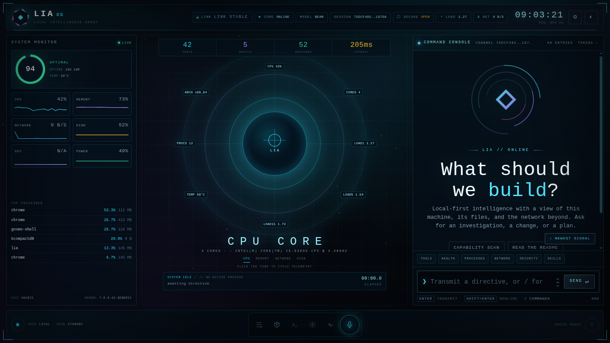

# lia

**A local-first AI assistant written in Rust.** One agent core, many ways to reach it: terminal, web, voice, and chat platforms. It runs on your machine, works inside your workspace, and asks before it acts.

[](docs/licence.md)


## Preview



## Why lia

- **Local-first.** Conversations, memory and skills live on your disk. You choose the model, including local ones through Ollama.
- **Does the work.** Reads and edits files, runs commands, searches the web, looks at screenshots, and reports exactly what it touched.
- **Safe by default.** Commands need your approval and are confined to your workspace by a sandbox. Strangers on chat platforms must be paired with a code the owner approves. See [Security](docs/security.md).
- **Resilient.** If a provider fails or runs out of credit, the next one in your fallback list takes over.
- **One agent, every surface.** The gateway exposes the same agent over HTTP and WebSocket, with adapters for Telegram, Discord, Slack and WhatsApp.
- **Extensible.** Add procedures as [skills](docs/skills.md) and borrow tools from any [MCP](docs/mcp.md) server.

## Features

| Area       | What you get                                                                                  |
| ---------- | --------------------------------------------------------------------------------------------- |
| Coding     | File reading and editing, sandboxed command execution, plans ticked off as work proceeds      |
| Memory     | Saved sessions, daily notes consolidated into durable facts, each tagged with its source      |
| Skills     | Written procedures loaded on demand (security audit, release checklist, incident triage, ...) |
| Multimodal | Pictures in, voice in and out                                                                 |
| Web        | Search and page reading                                                                       |
| Automation | Scheduled work: "check the build every half hour", answered in the chat that asked            |
| Delegation | Heavy jobs handed to a sub-assistant so the conversation stays clean                          |
| Providers  | Anthropic, OpenAI-compatible, Ollama, with retry and fallback                                 |

## Quick start

```sh
git clone <this repository>
cd lia
cargo build --release
cargo run -- --help
```

Copy [lia.example.toml](lia.example.toml) as a starting configuration, then follow [Install](docs/install.md) and [Configure](docs/configure.md).

## Documentation

**Getting started:** [What it does](docs/what-it-does.md) · [Install](docs/install.md) · [Configure](docs/configure.md) · [Use it](docs/use-it.md)

**Capabilities:** [Skills](docs/skills.md) · [Memory](docs/memory.md) · [Pictures](docs/pictures.md) · [Voice](docs/voice.md) · [The web](docs/the-web.md) · [MCP](docs/mcp.md) · [Scheduled work](docs/scheduled-work.md)

**Running it:** [The sandbox](docs/the-sandbox.md) · [The gateway](docs/the-gateway.md) · [Channels](docs/channels.md) · [Security](docs/security.md) · [Troubleshooting](docs/troubleshooting.md)

**Contributing:** [Development](docs/development.md) · [Layout](docs/layout.md) · [Roadmap](docs/roadmap.md) · [Skill authoring](docs/skill-authoring.md) · [Licence](docs/licence.md)

## Contributing

Issues and pull requests are welcome. Start with [Development](docs/development.md) and the [Roadmap](docs/roadmap.md) to see where help is most useful.

## License

MIT. See [Licence](docs/licence.md).
